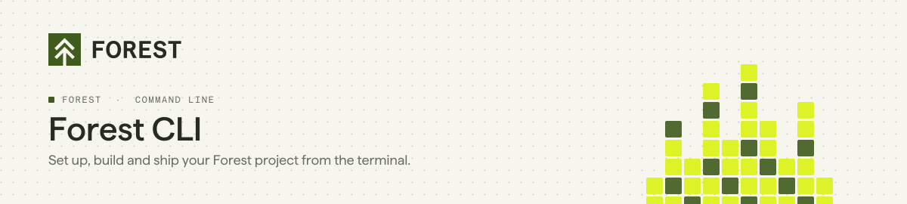

<p align="center">
  <picture>
    <source media="(prefers-color-scheme: dark)" srcset="./assets/header-toolbelt-dark.svg">
    
  </picture>
</p>

<p align="center">
  <a href="https://www.npmjs.com/package/forest-cli"></a>
  <a href="https://github.com/ForestAdmin/toolbelt/actions/workflows/build.yml"></a>
  <a href="./LICENSE"></a>
</p>

**Forest is the back office for operations teams in regulated companies.** Ops teams review, decide and act on your data from one interface, or let AI agents do it through MCP, within the roles, permissions and audit logs you define.

This repository is the **Forest CLI** (`forest`): it creates your project, boots its agent, and manages layouts, workflows, roles, users and environments from the terminal. Everything you do in the Forest settings, you can script, review and version.

## Quick start

```bash
npm install -g forest-cli
forest start
```

`forest start` takes you from nothing to a running back office: it logs you in, creates the project, boots its agent locally, and gives your coding agent the Forest skills to build on it. Pick a flow:

| Flow | For | Command |
|---|---|---|
| Demo | Seeing Forest on realistic data, no database needed | `forest start --flow demo` |
| Standalone | A Node.js agent generated on your SQL or MongoDB database | `forest start --flow standalone --db <DATABASE_URL>` |
| In-app | Mounting Forest in an app you already run (Rails, Node.js) | `forest start --flow inapp --stack rails` |

Add `--dry-run` to print every step instead of running it.
Full guide: [docs.forest.app/get-started/quickstart](https://docs.forest.app/get-started/quickstart)

## Requirements

| | |
|---|---|
| Node.js | `>= 18` |
| Account | A Forest account. `forest login` opens the browser to sign in. |

## Commands

Run `forest help <command>` for the flags of any command.

<details open>
<summary><b>Set up a project</b></summary>

| Command | What it does |
|---|---|
| `start` | Set up Forest from scratch: log in, create a project, boot its back-end, hand your coding agent the skills |
| `login` / `logout` / `user` | Sign in, sign out, show the logged-in user |
| `projects:create:demo` | Create a project with demo data, no database required |
| `projects:create:sql` / `projects:create:nosql` | Create a project with a Node.js agent generated on your SQL or MongoDB database |
| `projects:create:in-app` | Register a project for an app you host yourself and print its environment secret |
| `projects` / `projects:get` | List your projects, get a project's configuration |
| `skills:init` / `skills:update` | Install or refresh the Forest skills for your coding agent (Claude Code, Codex, Cursor, OpenCode…) |

</details>

<details open>
<summary><b>Build the back office</b></summary>

| Command | What it does |
|---|---|
| `layout:pull` / `layout:apply` | Pull an environment's layout into `forest-layout.json`, edit it, apply it back |
| `layout:patch` | Patch the layout directly from a JSON file or stdin |
| `workflow:apply` | Create or update a workflow from a JSON steps spec |
| `schema:update` / `schema:apply` / `schema:diff` | Refresh, apply or compare `.forestadmin-schema.json` |

</details>

<details>
<summary><b>Manage access</b></summary>

| Command | What it does |
|---|---|
| `users:list` / `users:invite` / `users:edit` | List, invite and edit users (role, teams, permission level) |
| `roles:create` / `roles:copy` | Create a role, copy role permissions between environments |
| `roles:export` / `roles:apply` | Export every role's permissions to a CSV, edit it, apply it back |
| `teams:create` / `teams:delete` / `teams:copy-layout` | Manage teams and copy a team's layout onto another |

</details>

<details>
<summary><b>Develop and deploy</b></summary>

| Command | What it does |
|---|---|
| `init` | Set up your development environment in the current folder |
| `branch` / `switch` / `set-origin` | Create, list and switch layout branches, set a branch's origin |
| `push` | Push the layout changes of your branch to its origin |
| `deploy` | Deploy layout changes to the reference environment |
| `environments` / `environments:get` | List environments, get an environment's configuration |
| `environments:create` / `environments:update` / `environments:delete` / `environments:reset` | Manage environments |

</details>

## With a coding agent

The CLI is built to be driven by an AI coding agent as well as by you. `forest skills:init` installs the Forest skills (the Forest plugin for Claude Code and Codex, plain skill files for the others), so your agent knows how to customize the agent code, edit layouts and write workflows with these commands. Listing and `get` commands accept `--format json`, and `layout:patch` and `workflow:apply` read their spec from stdin.

## Docker

```bash
docker run --rm --init -it \
  -v `pwd`:/usr/src/app \
  -v ~/.forest.d:/usr/src/cli/.forest.d \
  -e TOKEN_PATH="/usr/src/cli" \
  forestadmin/toolbelt:latest [command]
```

| Variable | Use |
|---|---|
| `TOKEN_PATH` | Where the session token is stored. Must be `/usr/src/cli` with the image. |
| `FOREST_ENV_SECRET` | Environment secret, for commands that target an environment |
| `DATABASE_URL`, `DATABASE_SCHEMA` | Database connection, for the commands that need one |
| `SILENT` | Do not log command results (optional) |

A `.env` file in the current folder is picked up; otherwise pass each variable with `-e`.

## Documentation

| | |
|---|---|
| Get started | https://docs.forest.app/get-started/quickstart |
| CLI reference | https://docs.forest.app/reference/cli/overview |

## Contributing

Bug reports and pull requests are welcome. See [CONTRIBUTING.md](./CONTRIBUTING.md) for setup, tests and commit conventions.

```bash
yarn install && yarn build && yarn test
```

## License

Apache-2.0. See [LICENSE](./LICENSE).
